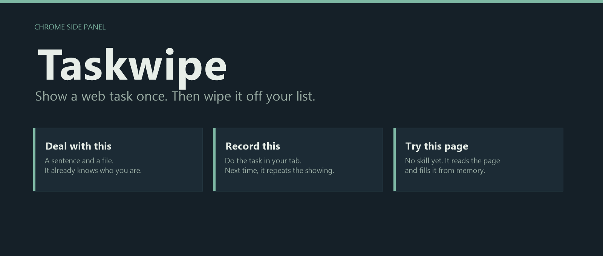

<p align="center">
  
</p>

# Show it once. It’s off your list.

Taskwipe sits in a Chrome side panel and works in the tab you already have open. You do a web task once, or you hand it a sentence and a file. It keeps **who you are**, **how you write**, and **the way that task actually goes**. Next time, the same work is a run, not an afternoon.

Hand it the task and the files. It already knows who you are.

## Three ways in

| | You | Taskwipe |
| --- | --- | --- |
| **Deal with this** | “Apply with my CV and transcript. Stop before submit.” Or a photo and “sell this.” | A job card before any click: the goal, the pages, the facts it will use, the files, and where it will stop. Then it goes. |
| **Record this** | Click through the task yourself. | A draft skill. You confirm what is you, what changes every run, and the playbook. **Run** repeats that showing. |
| **Try this page** | Open a form. There is no skill yet. | It reads the tab and fills from memory. A missing fact pauses and asks. You can keep the attempt as a skill. |

The page you are on decides what rises to the top. A skill for this site, or this kind of page, is listed first.

## What people actually hand it

**An application.** Put a CV and a transcript in the vault. Taskwipe reads them on upload and suggests the facts. Nothing is kept until you say so. “Apply with my CV and transcript” walks a multi-page form, attaches the transcript, and stops on Submit. Open a second site whose labels are different. The same person is already there.

**A listing from a photo.** “Sell this blue mug, used, ceramic and glazed, £2, medium, unbranded.” One look at the photo writes the title, the description, the price, the condition, the brand, the colour, the size, and the material. Vinted, eBay, and Facebook Marketplace are filled from that card. Leave out the price or the condition and the job card asks before it starts. Upload, List, and Publish wait for you.

**A caption worth keeping.** The address is you. The caption is how you write. Neither is buried inside a single playbook. A caption you keep goes in the example book, and the next one follows it.

**A page you have never recorded.** Try this page on whatever form is in front of you. Stored facts go straight in. Unknown fields stop and ask. Your profile is only updated when you confirm it.

## What it keeps

**Profile** is you: name, address, school, phone, the rest. An existing fact stays until you choose to overwrite it.

**Vault** is the files. Suggestions show the line they came from. Card numbers are skipped. Deleting a file also deletes facts that were cited only by that file.

**Activity** is the log of past runs: the procedure, how far it got, which facts it used, the lesson it wrote back, and Resume when a run is paused.

**Download profile and vault** zips the confirmed facts and the original files. Opening Profile, Vault, or Activity does not call a model.

Passwords are not stored. Files on a job stay in the side panel. The API sees names, and short text snippets.

## It stops before the irreversible click

Submit, Pay, Place order, Publish, List, and Upload are blocked before the click. You confirm. Then it clicks. A sign-in wall pauses on that site. Resume continues there after you sign in. A correction on pause can become a writing rule, or a lesson on that skill.

## Watch the two demos

Both run locally, in your own Chrome tab, with the side panel open. The hub is [http://127.0.0.1:8001/demo/](http://127.0.0.1:8001/demo/) once the API is up. The full script is [docs/DEMOS.md](docs/DEMOS.md).

1. **Apply** with a CV and a transcript. Stop before submit. Then the same facts on a form with different labels.
2. **Parcel and caption.** An address at checkout, then a caption you keep and reuse.

## Run it

Python 3.11+, Node 20+, Chrome, and a [Nebius Token Factory](https://tokenfactory.nebius.com/) key. Claude is only the fallback, and only when a Nebius call fails.

```powershell
git clone https://github.com/advcode118/nebiustaskwipe.git
cd nebiustaskwipe
python -m venv .venv
.\.venv\Scripts\Activate.ps1
pip install -r backend\requirements.txt
copy backend\.env.example backend\.env
```

Put `NEBIUS_API_KEY` in `backend/.env`. Add `ANTHROPIC_API_KEY` if you want the fallback, and `TAVILY_API_KEY` if a job needs a public page you are not already on.

```powershell
python backend\manage.py migrate
python backend\manage.py runserver 127.0.0.1:8001 --noreload
```

Build the side panel in a second terminal:

```powershell
cd overlay
npm install
npm run build
```

In Chrome, open `chrome://extensions`, turn on Developer mode, choose **Load unpacked**, and select the `extension` folder. Pin Taskwipe and open the side panel. The API field should be `http://127.0.0.1:8001`.

`GET http://127.0.0.1:8001/api/health/` returns `"ok": true` when the server is up, plus whether a Nebius key is set.

Port **8001** keeps Taskwipe clear of another Django app on 8000. On Windows, `--noreload` avoids the autoreloader hanging.

## Under the panel

A Chrome extension, a Django API, and SQLite. Every model decision goes to DeepSeek on Nebius Token Factory first. A photo uses the vision model. A public page can be fetched with Tavily. A `localhost` tab is never sent there. If Nebius fails, Claude answers that one call.

The map of models, endpoints, and data is [docs/HOW_IT_WAS_BUILT.md](docs/HOW_IT_WAS_BUILT.md).
